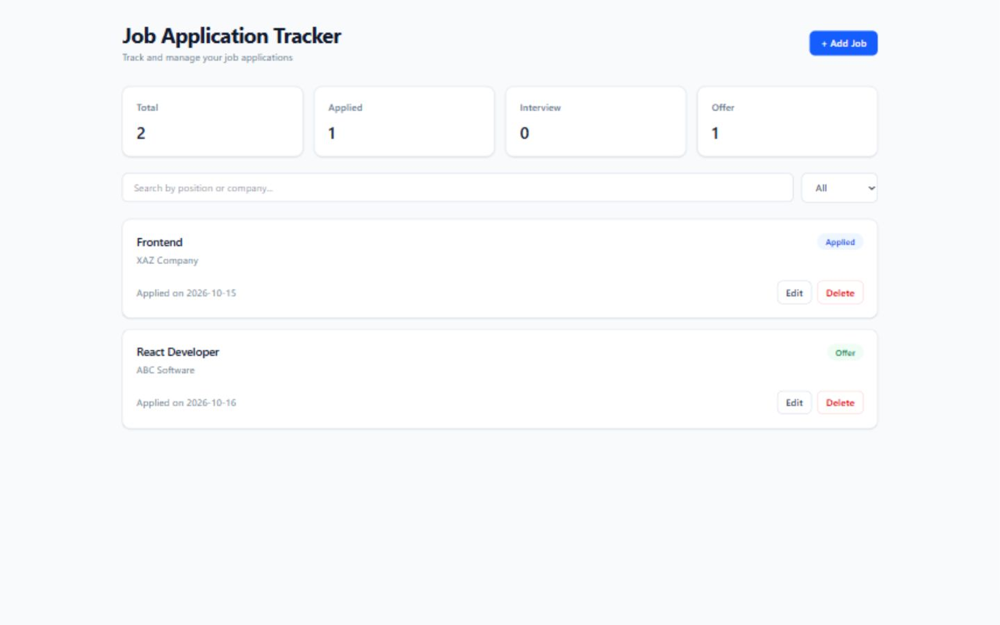
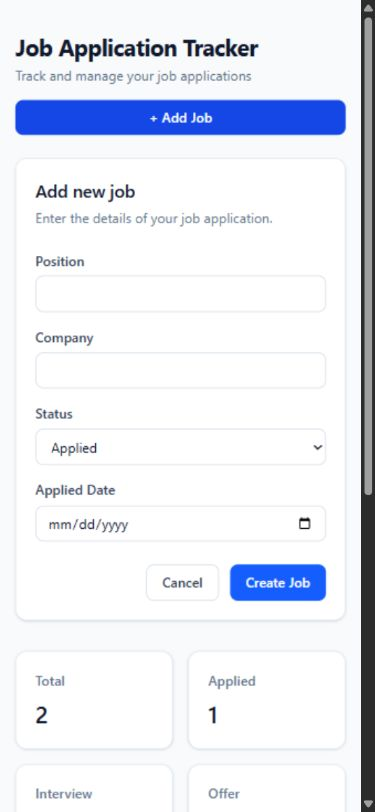

# Job Application Tracker

## Overview

A responsive frontend application for tracking job applications and practicing a real CRUD workflow connected to a backend API.

## Features

- View job applications
- Create, edit, and delete jobs
- Search by position or company
- Filter jobs by status
- Dashboard statistics for total, applied, interview, and offer jobs
- Form validation for required job fields
- Loading, error, empty, submitting, and deleting states
- Responsive layout
- Persistent job data through the project API/backend

## Tech Stack

- React
- TypeScript
- Vite
- Tailwind CSS
- React Hook Form
- Zod and `@hookform/resolvers`
- The project uses Supabase for its backend/API

## Frontend Architecture / Structure

- `App.tsx` owns application state, derived search/filter data, and async CRUD handlers.
- Reusable components render the job form, list, cards, statistics, search, and status filter.
- Shared `Job` types keep the UI and service layer aligned.
- `jobService` contains the REST API requests.
- React Hook Form and Zod handle form validation and edit-form values.

## Key Frontend Concepts Demonstrated

- Source state (`jobs`) and derived filtered data
- Immutable create, update, and delete state updates
- `useEffect` for initial API loading
- `async`/`await` with `try`/`catch`/`finally`
- Service layer separation for API requests
- TypeScript `Omit` and `Partial` for job payloads
- React Hook Form with Zod validation
- Default form values and edit-form synchronization
- Loading, error, empty, submitting, and deleting UI states
- Responsive Tailwind layouts and semantic status/action styling

## API Flow

```text
UI / Form
  → React handler
  → jobService
  → REST API
  → backend / database
  → response
  → React state
  → UI update
```

## Environment Variables

Create a `.env` file and provide the API endpoint used by the frontend:

```env
VITE_JOBS_API_URL=your-api-endpoint
```

Do not place secrets in frontend environment variables.

## Getting Started

1. Clone the repository.
2. Install dependencies:

   ```bash
   npm install
   ```

3. Create `.env` and set `VITE_JOBS_API_URL` to the job API endpoint.
4. Start the development server:

   ```bash
   npm run dev
   ```

Other available commands:

```bash
npm run lint
npm run build
npm run preview
```

## Project Structure

```text
src/
  components/
    JobCard.tsx
    JobForm.tsx
    JobList.tsx
    JobSearch.tsx
    JobStats.tsx
    JobToolbar.tsx
    StatusFilter.tsx
  services/
    jobService.ts
  types/
    job.ts
  App.tsx
```

## Screenshots

### Desktop



### Mobile



## What I Practiced / Learned

- React state and derived data
- TypeScript data modeling
- Form validation
- API integration
- Async UI states
- Responsive UI design fundamentals
- Semantic UI states and action hierarchy

## Status

The core CRUD frontend is complete and currently passes lint and build checks.
